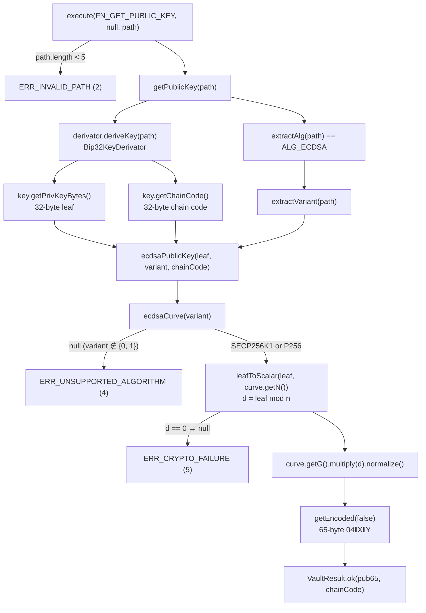
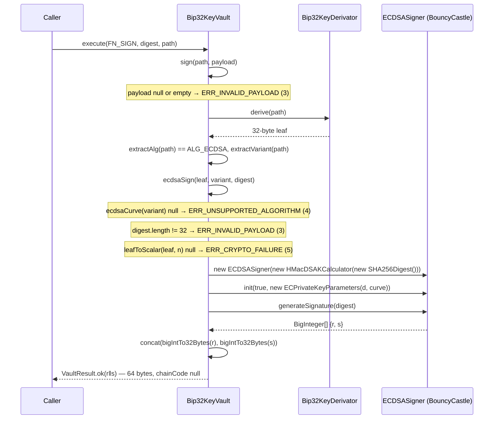

# ECDSA in the Vault (alg 3)

Updated: 2026-11-01 — mission 37.1.1

`Bip32KeyVault` derives ECDSA public keys and signs 32-byte digests for
`AlgField.ALG_ECDSA` (3). The level-4 `variant` selects the curve: 0 is
secp256k1, 1 is P-256. All other variants are rejected. ECDH is not supported for alg 3.

The derivation rule (leaf mod `n`, the FIPS 186-4 B.4.1 deviation, the
variant table) is specified in
[keymaster-wks/doc/key-derivation.md](../../keymaster-wks/doc/key-derivation.md),
section "ECDSA — `alg` 3". That section is the authority. This document
describes the code.

> Note: as of this writing the ECDSA section has been drafted for
> `key-derivation.md` but not yet applied there (it lives in a separate
> repository).

## Code Map

All paths are under `club.dwdc.keyvault.core/src/`.

| File | Member | Responsibility |
|---|---|---|
| `main/java/club/dwdc/keyvault/core/Bip32KeyVault.java` | `extractVariant(int[] path)` | Reads bits 15-8 of path level 4 (index 3) |
| | `ecdsaCurve(int variant)` | `0 → SECP256K1`, `1 → P256`, anything else `null` |
| | `leafToScalar(byte[] leaf, BigInteger n)` | `d = leaf mod n`, `null` when `d = 0`. `n` is passed in so tests can show that reducing mod `p` gives a different result |
| | `ecdsaPublicKey(byte[] leaf, int variant, byte[] chainCode)` | `G·d` as a 65-byte uncompressed point, plus the chain code |
| | `ecdsaSign(byte[] leaf, int variant, byte[] digest)` | RFC 6979 ECDSA, returns a 64-byte raw `r‖s` |
| | `getPublicKey` / `sign` | `case AlgField.ALG_ECDSA` arms that call the two methods above |
| | `bigIntTo32Bytes(BigInteger)` (existing) | Fixed 32-byte big-endian. It drops BigInteger's sign byte and left-pads short values |
| `main/java/club/dwdc/keyvault/core/AlgField.java` | class Javadoc | Documents `variant` as the ECDSA curve selector, and that `role` is defined per protocol. No behaviour change |
| `test/java/club/dwdc/keyvault/core/EcdsaTest.java` | 10 tests | One per DoD item. See [How It Is Tested](#how-it-is-tested) |

The four ECDSA methods are package-private and `static`, so tests can
inject a crafted leaf without going through BIP-32.

## Public Key Derivation

Entry point: `execute(FN_GET_PUBLIC_KEY, null, path)`.



In the code, `seed` in `getPublicKey` is the leaf (the 32-byte private
key at the full path), not the master seed:
`DeterministicKey key = derivator.deriveKey(path); byte[] seed = key.getPrivKeyBytes();`.
bitcoinj's `ECKey.getPrivKeyBytes()` pads to 32 bytes.

## Signing

Entry point: `execute(FN_SIGN, digest, path)`. `sign()` gets the leaf
through `derivator.derive(path)`, which is `deriveKey(path).getPrivKeyBytes()`.



The signer adds no low-S normalisation, and the vault does not hash: the
caller passes the digest.

## Data Formats

| Item | Size | Format |
|---|---|---|
| Leaf | 32 B | BIP-32 private key at the path, big-endian |
| Digest (input to `FN_SIGN`) | 32 B | Already hashed by the caller (SHA-256 for P-256) |
| Public key | 65 B | SEC1 uncompressed `04 ‖ X(32) ‖ Y(32)` |
| Chain code | 32 B | `DeterministicKey.getChainCode()`, returned in `VaultResult.chainCode()` |
| Signature | 64 B | Raw `r(32) ‖ s(32)`, each big-endian and left-padded. Not DER. `chainCode()` is null |

The public key is uncompressed on purpose. The Schnorr arm returns a
33-byte compressed key. The reason given in the mission spec is that
KeyMaster builds the SPKI and the PKCS#11 `CKA_EC_POINT` from the
uncompressed point. *(Inferred from the spec; that consumer is not in this repository.)*

The test wraps the key in a DER SubjectPublicKeyInfo for openssl by
prepending this fixed prefix
(SEQUENCE / AlgorithmIdentifier `id-ecPublicKey`, `prime256v1` / BIT STRING of 66 bytes):

```text
3059301306072a8648ce3d020106082a8648ce3d030107034200 || 04‖X‖Y
```

That prefix is valid for P-256 only. The vault itself never produces DER.

## Error Cases

| Condition | Where it is checked | `VaultResult` code |
|---|---|---|
| Path shorter than 5 levels | `execute` | `ERR_INVALID_PATH` (2) |
| Variant not 0 or 1 (including 4, Brainpool P256r1) | `ecdsaCurve` via `ecdsaPublicKey` / `ecdsaSign` | `ERR_UNSUPPORTED_ALGORITHM` (4) |
| `FN_SIGN` payload null or empty | `sign` | `ERR_INVALID_PAYLOAD` (3) |
| Digest length ≠ 32 | `ecdsaSign` (same code as `schnorrSign`) | `ERR_INVALID_PAYLOAD` (3) |
| `leaf mod n == 0` | `leafToScalar` returns null | `ERR_CRYPTO_FAILURE` (5) |
| Exception inside `ECDSASigner` | `ecdsaSign` catch | `ERR_CRYPTO_FAILURE` (5) |
| `FN_KEY_AGREEMENT` with alg 3 | `ecdh` default arm | `ERR_UNSUPPORTED_ALGORITHM` (4). *Not covered by `EcdsaTest`* |

`ecdsaSign` checks in this order: curve, then digest length, then scalar.
A bad variant combined with a bad digest therefore reports
`ERR_UNSUPPORTED_ALGORITHM`.

## How It Is Tested

`EcdsaTest`. The mnemonic is `abandon ×11 about` with no passphrase. The pinned
path is Alice's TLS-client key:

```text
m/44'/1240'/1955269225'/196866'/0'
  1240       = Protocol.X509
  1955269225 = mangle("alice@atlanta.com")
  196866     = AlgField(ALG_ECDSA, variant 1 = P-256, role 2 = TLS client)

pub        04b99b60d501f8c4410839779fbea199d87b83dd675ffba53223529adfd0f05ac8
           3c199adda4b7b7aaad50afd3ed4b230361e6ce56ea78790707cb7d84a81a2a81
chain code e387b481080f4915aeabcf832222ad93b0a381a218593ae7e8a9e46a9d5dd8cf
```

| Test | What it shows |
|---|---|
| `p256KeyAtPinnedPath` | The pub and chain code at the pinned path equal the golden hex above. The chain code also equals `deriveKey(PATH).getChainCode()` |
| `sameSeedAndPathSameKey` | Two separate vault instances from the same mnemonic give the same key |
| `signatureVerifiesWithOpenssl` | Writes `pub.der`, `digest.bin` and `sig.der` (r and s re-encoded as DER) to `target/ecdsa-openssl/`, then runs `openssl pkeyutl -verify` and expects `Signature Verified Successfully`. A digest with one bit flipped must be rejected. The test is skipped with a message if `openssl` is not on PATH |
| `signReturns64ByteRawRS` | The signature is 64 bytes with a null chain code and verifies with BouncyCastle as `r‖s`. `bigIntTo32Bytes` handles the 33-byte sign-byte case and short values |
| `craftedLeafAboveN` | The leaf `n + 1` gives `d = 1`, so the public key is the literal P-256 generator `G`. The hard-coded `n` and `G` match BouncyCastle |
| `reducingModPDiffers` | The same leaf reduced mod the field prime `p` stays `n + 1`, so a mod-`p` bug would be caught |
| `variantSelectsCurve` | Variant 0 and 1 at otherwise the same path give different keys, each a point on its own curve and not on the other. A variant-0 signature verifies on secp256k1 |
| `zeroScalarRejected` | The leaves `n` and all-zero map to null, and `ecdsaPublicKey` and `ecdsaSign` return `ERR_CRYPTO_FAILURE` |
| `digestNot32Rejected` | Lengths 31, 33 and 64, null and empty give `ERR_INVALID_PAYLOAD`. A Schnorr path gives the same code for 31 bytes |
| `unsupportedVariantsRejected` | Variants 4, 2 and 255 give `ERR_UNSUPPORTED_ALGORITHM` for both public key and sign |

Run the tests:

```text
mvn -pl club.dwdc.keyvault.core test -Dtest=EcdsaTest
```

To re-check the openssl artifacts by hand after a test run, from `club.dwdc.keyvault.core/`:

```text
openssl pkeyutl -verify -pubin -inkey target/ecdsa-openssl/pub.der -keyform DER \
  -in target/ecdsa-openssl/digest.bin -sigfile target/ecdsa-openssl/sig.der
```
